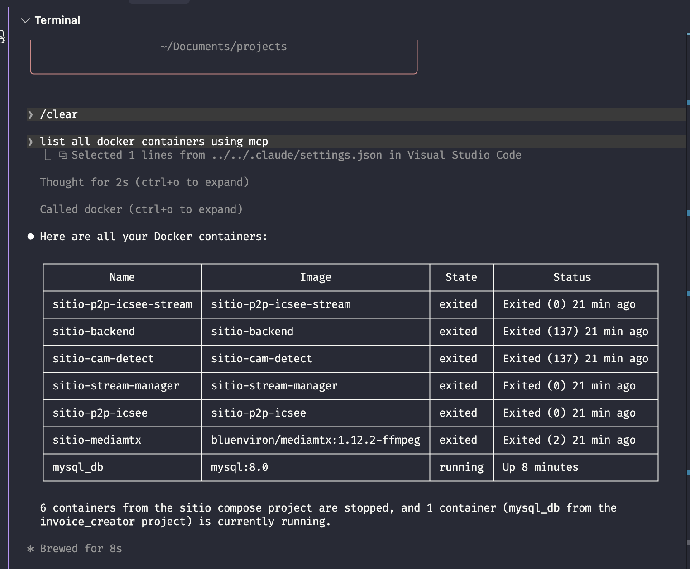

# mcp-docker

A Model Context Protocol (MCP) server that exposes Docker container operations as tools. It allows AI assistants like Claude to list, inspect, and read logs from Docker containers.



## Requirements

- Node.js >= 18
- Docker CLI installed and accessible in `PATH`
- Docker daemon running

## Installation

```bash
npm install
npm run build
```

## Usage

### As a standalone server

```bash
npm start
```

The server communicates over **stdio** using the MCP protocol.

### With Claude Code

Add to your Claude Code MCP settings (`.claude/settings.json`):

```json
{
  "mcpServers": {
    "docker": {
      "command": "node",
      "args": ["/path/to/mcp-docker/dist/index.js"]
    }
  }
}
```

### With Claude Desktop

Add to your Claude Desktop config (`claude_desktop_config.json`):

```json
{
  "mcpServers": {
    "docker": {
      "command": "node",
      "args": ["/path/to/mcp-docker/dist/index.js"]
    }
  }
}
```

## Tools

### `list_containers`

List Docker containers. By default shows only running containers.

| Parameter | Type | Required | Description |
|-----------|------|----------|-------------|
| `all` | `boolean` | No | Show all containers including stopped. Default: `false` |
| `format` | `"table" \| "json"` | No | Output format. Default: `json` |

### `inspect_container`

Get detailed information about a specific Docker container (equivalent to `docker inspect`).

| Parameter | Type | Required | Description |
|-----------|------|----------|-------------|
| `container` | `string` | Yes | Container ID or name |

### `container_logs`

Get logs from a specific Docker container.

| Parameter | Type | Required | Description |
|-----------|------|----------|-------------|
| `container` | `string` | Yes | Container ID or name |
| `tail` | `number` | No | Number of lines to show from the end. Default: `100` |

## Development

```bash
# Build
npm run build

# Run
npm start
```

## Tech Stack

- TypeScript 7
- MCP SDK (`@modelcontextprotocol/sdk`)
- Zod for input validation
- Node.js `child_process.execFile` for Docker CLI calls

## License

MIT
